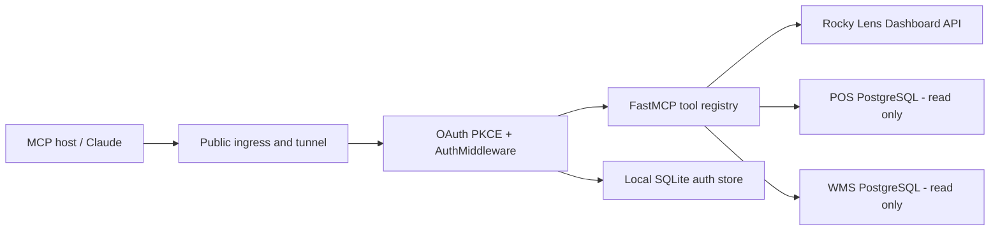

# Production Module Map

## Request flow

## Runtime modules

| Path | Production responsibility |
| --- | --- |
| `scripts/start_mcp_production_oauth.py` | Starts Uvicorn, serves `/health`, `/login`, `/authorize`, `/token`, and wraps `/mcp` with auth. |
| `mcp_server/server.py` | Defines MCP tools and global authorization boundary. |
| `mcp_server/auth.py` | Resolves bearer tokens from SQLite or Dashboard PostgreSQL and places identity in request context. |
| `mcp_server/local_auth.py` | Stores local users/API keys/OAuth codes. Password hashes use scrypt. |
| `mcp_server/payment_types.py` | Resolves Allocate-first/Receive-fallback payment document behavior. |
| `mcp_server/tools.py` | POS reporting queries, returns, customer, product, staff, and schema/spec helpers. |
| `mcp_server/dashboard_api.py` | Uses Dashboard API for UI-matching reporting results. |
| `mcp_server/wms_tools.py` | WMS live inventory and warehouse queries. |
| `mcp_server/ai_chat.py` | Optional natural-language assistant backend. |
| `mcp_server/prompts.py` | Tool-use and fallback prompt instructions. |

## Role policy

| Role | Scope |
| --- | --- |
| `admin` | Full permitted MCP tool surface. |
| `manager` | Store-scoped operational reporting; no raw SQL. |
| `staff` | Own-staff reporting where applicable; no raw SQL. |
| `bod` | Aggregate executive reports only. Raw SQL, WMS, detailed customer/revenue, operations, and schema/spec access are denied by a central allow-list. |

## Source configuration

All source connections are environment variables. The production source of truth is the protected Windows env file, not this repository. See `.env.example` for names only.

## Windows services

- `RockyMCP`: active production service.
- `RockyMCPStaging`: isolated staging service.
- `RockyMCPIngress`: public ingress/tunnel service, intentionally kept untouched during application release switches.

