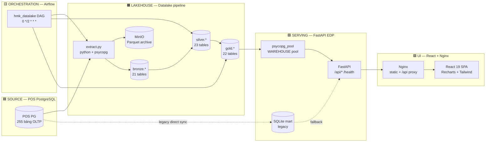
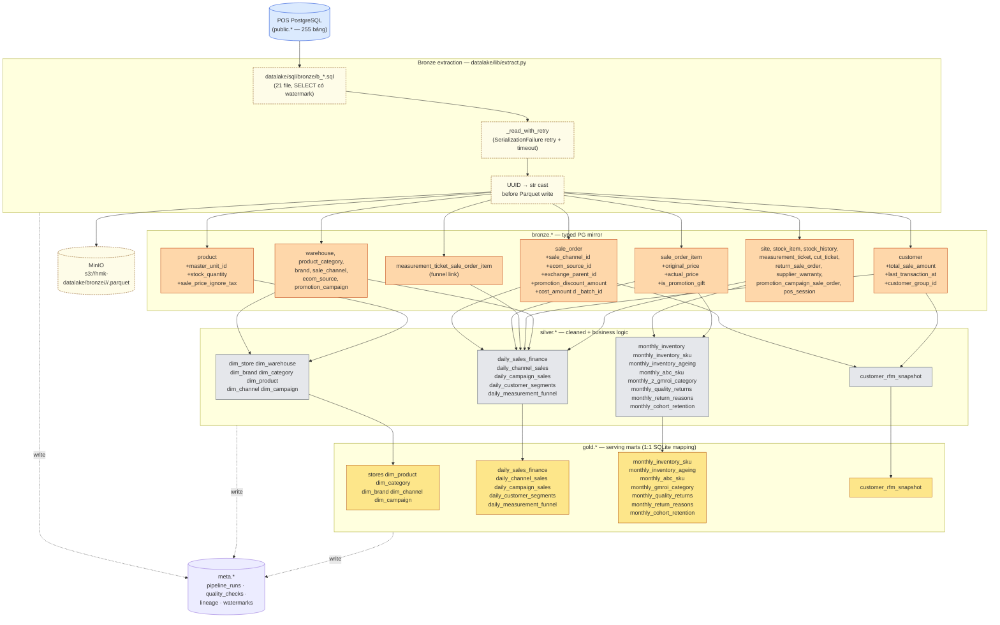
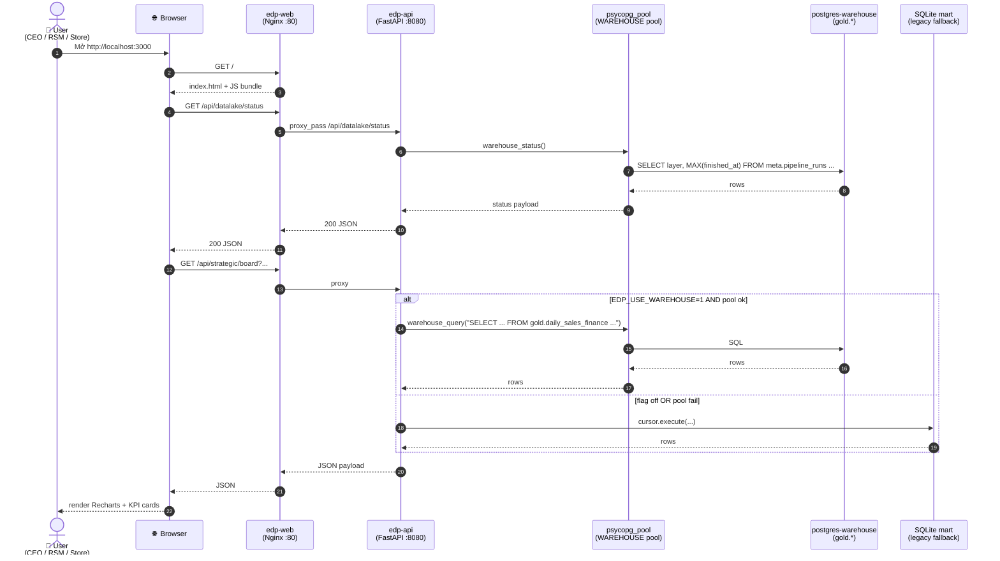
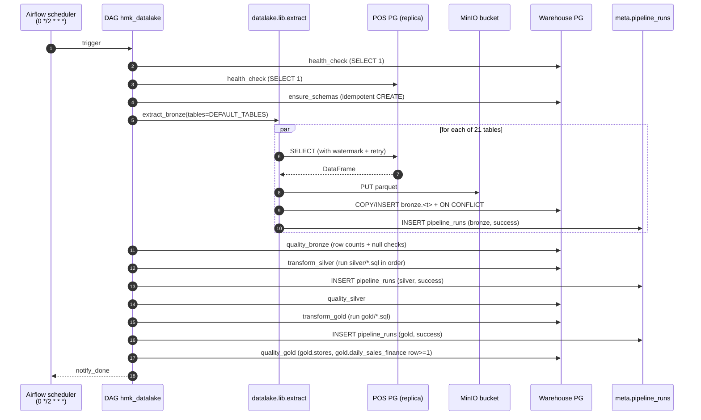
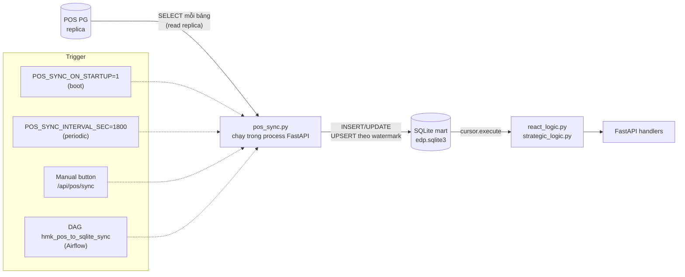
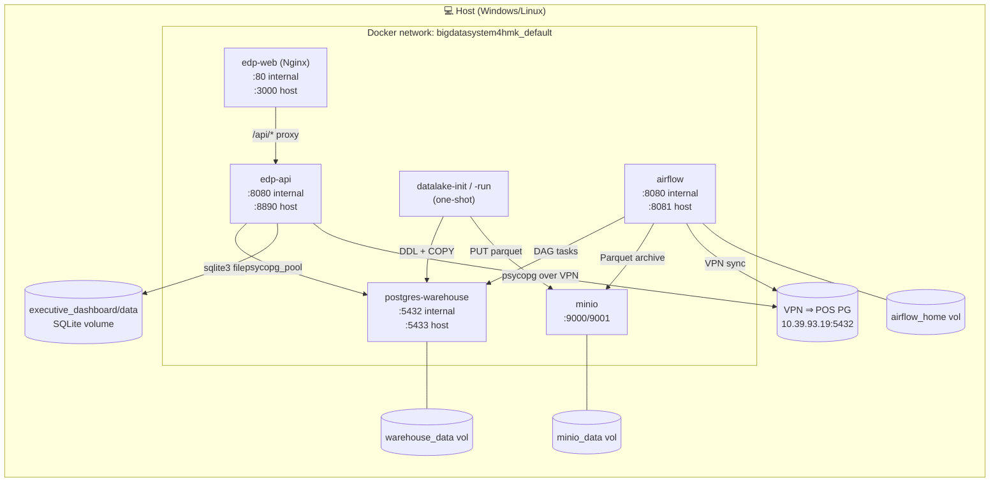

# Data flow — HMK BigData System

Diagram chi tiết luồng dữ liệu end-to-end của hệ thống: từ **POS PostgreSQL** (source
of truth) đến **dashboard React** mà user nhìn thấy. Tài liệu này dùng kèm
`docs/TECHSTACK.md` (liệt kê công nghệ) và `datalake/README.md` (chi tiết
mapping KPI ↔ gold tables).

Toàn bộ diagram dưới đây viết bằng **Mermaid** — render được trên GitHub, Cursor,
VS Code (extension Markdown Preview Mermaid), Obsidian. Bản PNG/SVG đã render sẵn
trong `docs/diagrams/`:


> Re-render khi sửa: `npx -y -p @mermaid-js/mermaid-cli mmdc -i docs/diagrams/dataflow_overview.mmd -o docs/diagrams/dataflow_overview.png -w 2200 -H 1300 --backgroundColor white`

---

## 1. Tổng quan — high-level pipeline



**Chú thích:**

- **Đường nét liền** = luồng dữ liệu chính (đang sống).
- **Đường nét đứt** = luồng legacy (đang phase-out khi `EDP_USE_WAREHOUSE=1` ổn định).
- Mỗi mũi tên xanh từ `POS` đi qua `extract.py` mang 21 bảng nguồn (xem `datalake/sql/bronze/*.sql`).

---

## 2. Lakehouse chi tiết — Bronze → Silver → Gold



**Bảng dependency thứ tự bắt buộc trong Silver:**

| Order prefix | File | Dependency |
|---|---|---|
| `s_00_*` | `dim_warehouse, dim_brand, dim_category, dim_product, dim_channel, dim_campaign` | Chỉ phụ thuộc bronze.* |
| `s_daily_*`, `s_monthly_*` (no `z_`) | Daily/monthly marts | Đọc dim_* + bronze |
| `s_monthly_z_gmroi_category` | GMROI | Cần `monthly_inventory_sku` đã sinh trước |
| `s_customer_rfm_snapshot` | RFM | Đọc `daily_sales_finance` |

Naming convention: alphabetical execution → `s_00_*` (dim) ⇒ `s_*` (daily/monthly) ⇒ `s_*_z_*` (depends on prior mart).

---

## 3. Request flow — UI hits dashboard



**Tham chiếu code:**

- Pool/feature flag: `executive_dashboard/app/warehouse.py`
- Legacy SQLite reader: `executive_dashboard/app/react_logic.py`
- Router lakehouse status: `executive_dashboard/app/routers/datalake.py`
- Nginx proxy: `executive_dashboard_frontend/nginx.conf`

---

## 4. Lakehouse pipeline run — Airflow DAG sequence



Manual override:

```bash
# Trigger ngoài Airflow (1 shot full pipeline)
docker compose --profile datalake-run run --rm datalake-run

# Hoặc local Python:
python datalake/scripts/run_pipeline.py full --lookback-days 90
```

---

## 5. Legacy sync path — POS → SQLite (đang phase-out)



**Status sync:** quan sát qua `GET /health` → field `pos_sync.last_status` /
`last_message` / `last_sync_at_utc`. Watermark lưu trong bảng `sync_state` (SQLite).

**Migration plan:** khi `tools/validate_warehouse_vs_sqlite.py` ≥ 99% parity, bật
`EDP_USE_WAREHOUSE=1` → `react_logic.py` đọc thẳng `gold.*`, sync legacy được tắt
(`POS_SYNC_INTERVAL_SEC=0`, gỡ DAG cũ).

---

## 6. Docker network — physical view



**Cổng đã expose host:**

| Service | Host:Container | URL |
|---------|----------------|-----|
| `edp-web` | 3000:80 | http://localhost:3000 |
| `edp-api` | 8890:8080 | http://localhost:8890 |
| `postgres-warehouse` | 5433:5432 | `psql -h localhost -p 5433 -U hmk` |
| `minio` (API) | 9000:9000 | http://localhost:9000 |
| `minio` (Console) | 9001:9001 | http://localhost:9001 |
| `airflow` | 8081:8080 | http://localhost:8081 |

---

## 7. Data contracts (tóm tắt)

| Contract | Quy ước | Nơi enforce |
|----------|---------|-------------|
| Timezone cắt ngày | `SYNC_TZ=Asia/Ho_Chi_Minh` → `d DATE` derived | `datalake/lib/loader.py:DATE_SOURCE`, `pos_sync.py` |
| Currency | VND, đơn vị **đồng** nguyên (số nguyên), không cent | Bronze giữ `DOUBLE PRECISION`; serving cast int |
| New vs returning customer | First purchase < lookback window (mặc định 90d) | `silver/s_daily_customer_segments.sql` |
| Funnel link | `bronze.measurement_ticket_sale_order_item` → SaleOrderItem → SaleOrder | `silver/s_daily_measurement_funnel.sql` |
| Inventory unit | 1 row `bronze.stock_item` = 1 unit; sold from `sale_order_item.quantity` | `silver/s_monthly_inventory*.sql` |
| Soft delete | Mọi bảng có `delete_at` ≠ NULL bị loại trong silver | Silver WHERE clauses |
| GMROI dependency | Cần `monthly_inventory_sku` chạy xong | filename `s_monthly_z_gmroi_category.sql` |

Đầy đủ data contract POS: `docs/schema-pos-postgresql-da.md` §12.

---

## 8. Quick reference — KPI ↔ Gold table ↔ UI page

| Page React | KPI/chart | Gold table | Silver script |
|-----------|-----------|-----------|---------------|
| Executive Summary | Revenue, GPM, channel mix | `daily_sales_finance`, `daily_channel_sales`, `monthly_z_gmroi_category` | `s_daily_sales_finance.sql`, `s_daily_channel_sales.sql`, `s_monthly_z_gmroi_category.sql` |
| Sales & Marketing | Campaign perf, customer mix, funnel | `daily_campaign_sales`, `daily_customer_segments`, `daily_measurement_funnel` | `s_daily_campaign_sales.sql`, `s_daily_customer_segments.sql`, `s_daily_measurement_funnel.sql` |
| Inventory & Supply Chain | ABC, ageing, GMROI treemap | `monthly_abc_sku`, `monthly_inventory_ageing`, `monthly_gmroi_category` | `s_monthly_abc_sku.sql`, `s_monthly_inventory_ageing.sql`, `s_monthly_z_gmroi_category.sql` |
| Quality & CLV | Pareto, RFM, cohort retention | `monthly_return_reasons`, `customer_rfm_snapshot`, `monthly_cohort_retention` | `s_monthly_return_reasons.sql`, `s_customer_rfm_snapshot.sql`, `s_monthly_cohort_retention.sql` |

Bảng đầy đủ + công thức: `datalake/README.md` mục **"KPI & dashboard"**.
