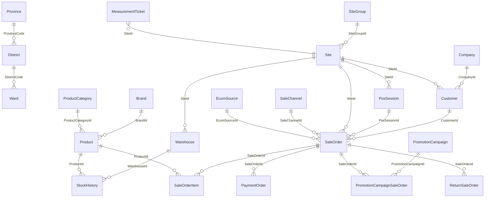
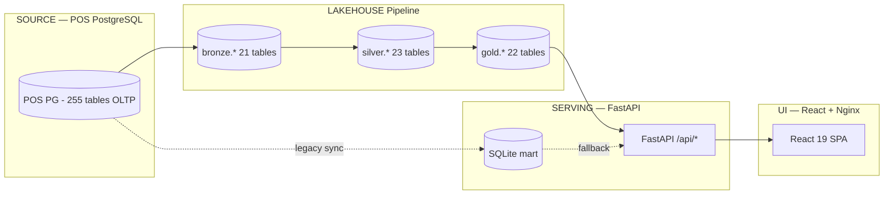
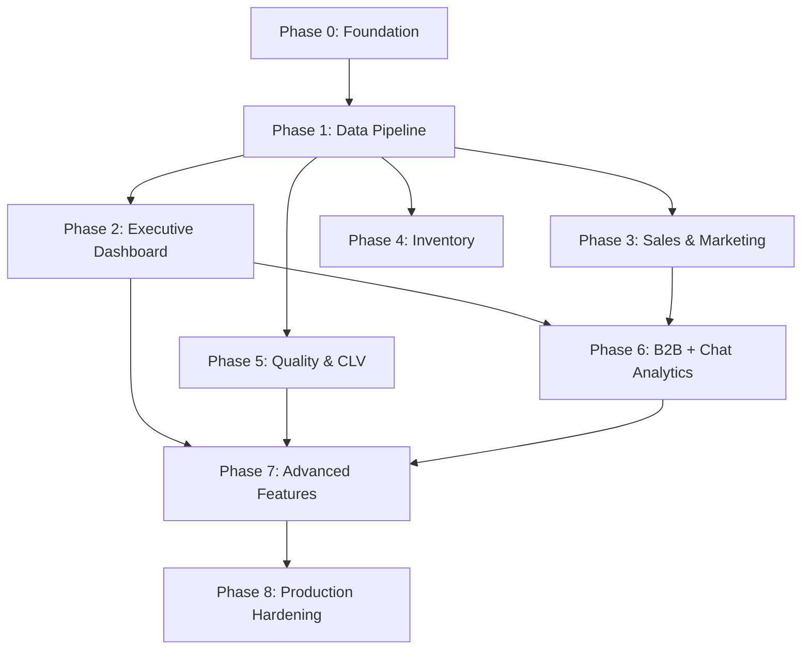

# ROCKY LENS DASHBOARD — COMPLETE SPECIFICATION

> Tài liệu tổng hợp toàn bộ kiến trúc database, công thức tính KPI, phân tích chat analytics,
> thiết kế UI và lộ trình triển khai cho hệ thống Rocky Lens Dashboard.

---

## MỤC LỤC

1. [Kiến trúc Database](#1-kiến-trúc-database)
2. [Công thức tính các trường dữ liệu](#2-công-thức-tính-các-trường-dữ-liệu)
3. [Chat Analytics (Conversation Analytics)](#3-chat-analytics-conversation-analytics)
4. [B2B Dashboard](#4-b2b-dashboard)
5. [Thiết kế UI (UI Design Specification)](#5-thiết-kế-ui)
6. [Lộ trình triển khai (Implementation Phases)](#6-lộ-trình-triển-khai)

---

# 1. KIẾN TRÚC DATABASE

## 1.1 Tổng quan hệ thống

```
┌─────────────────┐    ┌──────────────────────┐    ┌─────────────────────┐    ┌───────────────┐
│  POS PostgreSQL │ →  │  Lakehouse Pipeline  │ →  │  Warehouse PG       │ →  │  FastAPI EDP  │ → React UI
│  (255 tables)   │    │  Bronze/Silver/Gold  │    │  bronze.* silver.*  │    │  + SQLite     │   (Nginx)
│  OLTP source    │    │  Parquet + MinIO     │    │  gold.* meta.*      │    │  fallback     │
└─────────────────┘    └──────────────────────┘    └─────────────────────┘    └───────────────┘
        │                       ▲                                                      │
        │   pos_sync.py         │                                                      │
        └───────────────────────┘──── SQLite mart legacy path (đang phase-out) ────────┘
```

**Bốn miền lớn:**
1. **Source POS** — PostgreSQL OLTP (255 bảng, 582 FK, schema `public`)
2. **Lakehouse Pipeline** — Bronze → Silver → Gold (Parquet archive + MinIO)
3. **Serving Layer** — FastAPI + psycopg_pool (gold.*) / SQLite fallback
4. **Frontend** — React 19 SPA + Nginx reverse proxy

## 1.2 Quy ước dữ liệu chung

| Quy ước | Mô tả |
|---------|--------|
| **Soft Delete** | `DeleteAt IS NULL` = record active. Tất cả bảng POS đều có |
| **Timezone** | `SYNC_TZ=Asia/Ho_Chi_Minh`; timestamps lưu UTC, convert khi cắt ngày |
| **Currency** | VND, đơn vị đồng nguyên (integer), không cent |
| **PK** | Hầu hết UUID; một số bảng địa lý dùng `Code integer` |
| **Incremental Sync** | Watermark `UpdateAt` + overlap days; `INSERT ... ON CONFLICT DO UPDATE` |

## 1.3 Sơ đồ quan hệ lõi (Entity Relationship)



## 1.4 Bảng POS PostgreSQL cốt lõi (Data Dictionary)

### Site (Cửa hàng)

| Cột | Kiểu | Mô tả |
|-----|------|--------|
| `Id` | uuid | PK — định danh cửa hàng |
| `Name` / `StoreName` / `Code` | varchar | Tên/mã hiển thị |
| `SiteGroupId` | uuid FK | Nhóm/cluster cửa hàng (ASM) |
| `ProvinceCode` / `DistrictCode` / `WardCode` | integer FK | Địa lý |
| `Lat` / `Long` | double | Tọa độ |
| `State` | integer | Trạng thái hoạt động |
| `DeleteAt` | timestamptz | Soft delete |

### SaleOrder (Đơn hàng — Header)

| Cột | Kiểu | Mô tả |
|-----|------|--------|
| `Id` | uuid | PK — 1 dòng = 1 đơn |
| `SiteId` | uuid FK → Site | Cửa hàng tạo đơn |
| `CustomerId` | uuid FK → Customer | Khách hàng |
| `PosSessionId` | uuid FK | Ca POS |
| `StaffId` / `RefractionistStaffId` | uuid FK | Nhân viên bán / đo mắt |
| `IssueAt` / `SubmitAt` / `CompleteAt` / `CancelAt` | timestamptz | Mốc thời gian |
| `NeedPayAmount` | bigint | **Doanh thu net** (sau giảm giá) |
| `DiscountAmount` / `PromotionDiscountAmount` | bigint | Giảm giá |
| `PaidAmount` / `CustomerPaid` | bigint | Thanh toán |
| `SaleChannelId` / `EcomSourceId` | uuid FK | Kênh bán |
| `DeleteAt` | timestamptz | Soft delete |

### SaleOrderItem (Dòng hàng)

| Cột | Kiểu | Mô tả |
|-----|------|--------|
| `Id` | uuid | PK |
| `SaleOrderId` | uuid FK → SaleOrder | Đơn cha |
| `ProductId` | uuid FK → Product | SKU |
| `Quantity` | integer | Số lượng |
| `SubTotal` | bigint | Doanh thu dòng |
| `SubTotalCostPrice` | bigint | **COGS dòng** |
| `IsPromotionGift` | boolean | Quà tặng KM |
| `DeleteAt` | timestamptz | Soft delete |

### Customer (Khách hàng)

| Cột | Kiểu | Mô tả |
|-----|------|--------|
| `Id` | uuid | PK |
| `Phone` / `Email` / `FullName` | varchar | Liên hệ |
| `CustomerGroupId` | uuid FK | Phân nhóm |
| `SiteId` | uuid FK | Cửa hàng quản lý |
| `CurrentDebtAmount` | bigint | Công nợ hiện tại |
| `TotalSaleAmount` | bigint | Tổng mua lũy kế |
| `LastTransactionAt` | timestamptz | Giao dịch gần nhất |
| `DeleteAt` | timestamptz | Soft delete |

### Product / Brand / ProductCategory

| Bảng | Cột chính | Mô tả |
|------|-----------|--------|
| Product | `Id`, `Code`, `Name`, `ProductCategoryId`, `BrandId`, `SalePrice`, `CostPrice`, `StockQuantity` | Dimension SKU |
| Brand | `Id`, `Name` | Thương hiệu |
| ProductCategory | `Id`, `Name` | Danh mục |

### Warehouse / StockHistory / StockItem (Kho & Tồn)

| Bảng | Cột chính | Mô tả |
|------|-----------|--------|
| Warehouse | `Id`, `SiteId` FK, `Name` | Kho theo cửa hàng |
| StockHistory | `WarehouseId`, `ProductId`, `Quantity`, `EndStock`, `CostPrice`, `IsReturn`, `CreateAt` | Fact biến động tồn |
| StockItem | `WarehouseId`, `ProductId`, `InboundAt`, `OutboundAt`, `DamageAt`, `CostPrice` | Snapshot tồn |

### MeasurementTicket (Khám mắt)

| Cột | Kiểu | Mô tả |
|-----|------|--------|
| `Id` | uuid | PK |
| `SiteId` | uuid FK | Cửa hàng |
| `CustomerId` | uuid FK | Khách (nếu có) |
| `IssueAt` | timestamptz | Thời điểm phát hành |

### Các bảng bổ trợ

| Bảng | Vai trò |
|------|---------|
| `SaleChannel` / `EcomSource` | Dimension kênh bán |
| `PromotionCampaign` / `PromotionCampaignSaleOrder` | Chiến dịch KM → đơn |
| `ReturnSaleOrder` / `ReturnSaleOrderItem` | Đổi trả |
| `SupplierWarranty` | Bảo hành hãng |
| `PaymentOrder` / `PaymentMethod` | Thanh toán |
| `PosSession` / `PosSessionStaff` | Ca bán hàng |
| `Attendance` | Chấm công |
| `CommissionItem` | Hoa hồng |
| `StockDamage` / `StockDamageItem` | Hỏng hóc |
| `CouponCampaign` / `Coupon` | Voucher |

## 1.5 Lakehouse Pipeline (Bronze → Silver → Gold)

### Bronze Layer (21 bảng)

Mirror POS, snake_case, thêm `d DATE` derived, `_extracted_at`, `_batch_id`:

| Bảng | Nguồn POS |
|------|-----------|
| `sale_order` | SaleOrder + channel/ecom/exchange/promotion fields |
| `sale_order_item` | SaleOrderItem + original_price, actual_price |
| `customer` | Customer + total_sale_amount, last_transaction_at |
| `product` | Product + master_unit, stock_quantity |
| `warehouse` | Warehouse |
| `product_category` / `brand` | Dimensions |
| `sale_channel` / `ecom_source` | Channel dims |
| `promotion_campaign` | Campaign dim |
| `measurement_ticket_sale_order_item` | Funnel link |
| `site` / `stock_item` / `stock_history` | Store + inventory |
| `measurement_ticket` / `cut_ticket` | Service tickets |
| `return_sale_order` / `supplier_warranty` | Quality |
| `promotion_campaign_sale_order` / `pos_session` | Links |

### Silver Layer (23 bảng)

| Nhóm | Bảng | Mô tả |
|------|------|--------|
| Dimensions (6) | `dim_store`, `dim_warehouse`, `dim_brand`, `dim_category`, `dim_product`, `dim_channel`, `dim_campaign` | Cleaned dims |
| Daily marts (5) | `daily_sales_finance`, `daily_channel_sales`, `daily_campaign_sales`, `daily_customer_segments`, `daily_measurement_funnel` | Grain: store × day |
| Monthly marts (8) | `monthly_inventory`, `monthly_inventory_sku`, `monthly_inventory_ageing`, `monthly_abc_sku`, `monthly_z_gmroi_category`, `monthly_quality_returns`, `monthly_return_reasons`, `monthly_cohort_retention` | Grain: store × month |
| Snapshots (1) | `customer_rfm_snapshot` | RFM per customer |
| Leaderboard (2) | `monthly_store_leaderboard`, `monthly_csat_store` | Derived rankings |

### Gold Layer (22 bảng)

Passthrough / aggregation từ Silver, map 1:1 với SQLite mart cũ cho zero-downtime cutover.

### Meta Schema

| Bảng | Mô tả |
|------|--------|
| `pipeline_runs` | Log mỗi run: started/finished/status/rows/error |
| `quality_checks` | Row-count delta, null-rate |
| `lineage` | 27 transforms tracked |
| `watermarks` | Incremental sync state |

## 1.6 SQLite Snapshot (Serving trung gian)

| Nhóm | Bảng SQLite |
|------|-------------|
| Master | `regions`, `stores`, `holidays` |
| Finance | `daily_revenue`, `daily_sales_finance` |
| Customer | `daily_store_signals`, `daily_customer_segments`, `monthly_customer_retention` |
| Channel/Campaign | `daily_channel_sales`, `daily_campaign_sales` |
| Funnel | `daily_measurement_funnel`, `monthly_funnel_steps` |
| Inventory | `monthly_inventory`, `monthly_inventory_sku`, `monthly_inventory_ageing` |
| Quality | `monthly_quality_returns`, `monthly_return_reasons` |
| Payment/Session | `daily_payment_methods`, `daily_pos_sessions` |
| RFM | `customer_rfm_snapshot` |
| CSAT | `daily_ratings`, `monthly_csat` |
| Derived | `monthly_store_leaderboard`, `monthly_csat_store` |
| Target | `monthly_targets` |
| Sync state | `sync_state`, `sync_runs` |

## 1.7 Data Flow Diagram



## 1.8 Request Flow

```
User → Browser → Nginx (:80/:3000) → GET /api/react/* → FastAPI (:8080)
  → psycopg_pool → PostgreSQL warehouse (gold.*)
  → (fallback) SQLite cursor
  → JSON response → Recharts render
```

---

# 2. CÔNG THỨC TÍNH CÁC TRƯỜNG DỮ LIỆU

## 2.1 Finance — Tài chính

### Revenue (Doanh thu)

| KPI | Công thức | Nguồn POS |
|-----|-----------|-----------|
| **Total Revenue** | `SUM(revenue_net)` từ `daily_sales_finance` trong kỳ | `SaleOrder.NeedPayAmount` |
| **Revenue Trend %** | `(rev_current - rev_prev) / rev_prev × 100` | So sánh kỳ trước cùng độ dài |

```sql
SELECT source_store_id, DATE(o."CompleteAt" AT TIME ZONE 'Asia/Ho_Chi_Minh') AS d,
       SUM(o."NeedPayAmount") AS revenue_net
FROM "SaleOrder" o
WHERE o."DeleteAt" IS NULL AND o."CompleteAt" IS NOT NULL
GROUP BY source_store_id, d
```

### GPM (Gross Profit Margin)

| KPI | Công thức | Nguồn |
|-----|-----------|-------|
| **GPM %** | `SUM(gross_profit) / SUM(revenue_net) × 100` | `daily_sales_finance` |
| **gross_profit** | `revenue_net - cogs_amount` | `SaleOrderItem.SubTotalCostPrice` |

### NPM (Net Profit Margin — Proxy)

| KPI | Công thức |
|-----|-----------|
| **NPM %** | `(revenue - cogs - opex_proxy) / revenue × 100` |
| **opex_proxy** | `revenue × EDP_OPEX_PROXY_PCT` (mặc định 12%) |

### ATV (Average Transaction Value)

| KPI | Công thức |
|-----|-----------|
| **ATV** | `SUM(revenue_net) / SUM(orders_n)` |

### Revenue per Staff

| KPI | Công thức |
|-----|-----------|
| **Rev/Staff** | `Tổng doanh thu kỳ / SUM(stores.staff_count)` |
| **Default** | `staff_count = 12` nếu chưa có dữ liệu |

## 2.2 Customer — Khách hàng

### Churn Rate (Proxy)

| KPI | Công thức |
|-----|-----------|
| **Churn %** | `(1 - tỷ_lệ_repeat) × 100` |

Logic: KH có đơn hoàn tất trước đó = repeat; churn = không repeat.

### UPT (Units Per Transaction)

| KPI | Công thức | Nguồn POS |
|-----|-----------|-----------|
| **UPT** | `SUM(units_sold) / SUM(orders_n)` | `SUM(SaleOrderItem.Quantity) / COUNT(DISTINCT SaleOrder.Id)` |

### Remake Rate

| KPI | Công thức |
|-----|-----------|
| **Remake %** | `SUM(remake_orders_n) / SUM(orders_n) × 100` |

Logic POS: Đơn có MeasurementTicket gắn cùng CustomerId + SiteId trong ±14 ngày trước CompleteAt → coi là remake/refit.

### Customer Segments

| Segment | Logic |
|---------|-------|
| **Khách mới** | `CustomerId` không có `SaleOrder.CompleteAt` nào trước đó |
| **Khách quay lại** | `CustomerId` có ít nhất 1 đơn hoàn tất trước |
| **Khách ngủ đông** | inactive_customers_n (cần CRM data) |

### Customer Retention (Set-diff Monthly)

| KPI | Công thức |
|-----|-----------|
| **Retention %** | `retained / customers_prev × 100` |
| **Churn %** | `churned / customers_prev × 100` |

```
customers_prev = KH có đơn tháng M-1
retained       = KH có đơn cả tháng M-1 VÀ M
new_acquired   = KH có đơn tháng M nhưng KHÔNG có tháng M-1
churned        = KH có đơn tháng M-1 nhưng KHÔNG có tháng M
```

### RFM Segmentation

| Segment | Điều kiện |
|---------|-----------|
| **Champion** | recency ≤ 30 ngày AND frequency ≥ 3 |
| **Loyal** | recency ≤ 60 ngày AND frequency ≥ 2 |
| **At-Risk** | recency ≤ 120 ngày |
| **Hibernating** | recency ≤ 365 ngày |
| **Lost** | recency > 365 ngày |

POS: `recency = NOW() - MAX(SaleOrder.CompleteAt)`, `frequency = COUNT(DISTINCT SaleOrder.Id)`, `monetary = SUM(NeedPayAmount)`

### CLV (Customer Lifetime Value)

| KPI | Công thức |
|-----|-----------|
| **CLV TB** | `SUM(revenue) / COUNT(DISTINCT customers có giao dịch)` |

## 2.3 Inventory — Tồn kho

### Dead Stock %

| KPI | Công thức |
|-----|-----------|
| **Dead Stock %** | `COUNT(qty ≤ 0 OR is_return) / COUNT(*) × 100` (proxy StockHistory) |
| **Dead Stock SKU** | `sold_units = 0 AND age_days ≥ threshold` (mặc định 90 ngày) |

### Stock Cover Days

| KPI | Công thức |
|-----|-----------|
| **Stock Cover** | `AVG(EndStock) / AVG(ABS(Quantity))` ngày |
| **Cap** | Tối đa 3650 ngày |

### GMROI (Gross Margin Return on Inventory)

| KPI | Công thức |
|-----|-----------|
| **GMROI** | `SUM(gross_profit) / SUM(inventory_value)` |

### OOS (Out of Stock) %

| KPI | Công thức |
|-----|-----------|
| **OOS %** | `COUNT(stock_units ≤ 0 AND sold_units > 0) / COUNT(*) × 100` |

### STR (Sell-Through Rate)

| KPI | Công thức |
|-----|-----------|
| **STR %** | `SUM(sold_units) / (SUM(sold_units) + SUM(stock_units)) × 100` |

### Inventory Ageing (4 buckets)

| Bucket | Điều kiện |
|--------|-----------|
| < 30 ngày | `age_days ≤ 30` |
| 31–90 ngày | `30 < age_days ≤ 90` |
| 91–180 ngày | `90 < age_days ≤ 180` |
| > 180 ngày | `age_days > 180` |

POS: `age_days = EXTRACT(day FROM NOW() - StockItem.InboundAt)`

### Inventory Turnover

| KPI | Công thức |
|-----|-----------|
| **Turnover** | `COGS / Average Inventory Value` |

### On Shelf Availability (OSA)

| KPI | Công thức |
|-----|-----------|
| **OSA** | `Số SKU đang có hàng / Tổng SKU cần bán` |

## 2.4 Quality & Service

### CSAT (Customer Satisfaction)

| Nguồn | Công thức | Khi nào dùng |
|-------|-----------|--------------|
| **Real** (ZnsDb) | `AVG(score) × 20` (scale 0–100) | Khi có `ZNS_PG_DSN` |
| **Proxy** | `5 - defect_rate × 8` (scale 1–5) | Fallback khi không có ZNS |

`defect_rate = (return_orders + warranty_cases) / total_orders`

### Return/Warranty Quality

| KPI | Công thức | Nguồn POS |
|-----|-----------|-----------|
| **Tỷ lệ đổi trả** | `(return_orders + warranty_cases) / orders × 100` | `ReturnSaleOrder` + `SupplierWarranty` |
| **Return Amount** | `SUM(ReturnSaleOrder.NeedPayAmount)` | ReturnSaleOrder |

### Cohort Retention

| KPI | Công thức |
|-----|-----------|
| **Cohort size** | `SUM(new_customers_n)` tháng cohort |
| **Retention M+n** | `base_retention × decay[n]` |
| **decay** | `[1.0, 0.62, 0.42, 0.31, 0.24, 0.18]` |

## 2.5 Sales & Marketing

### Conversion Funnel (5 steps)

| Step | Nguồn | Proxy nếu thiếu |
|------|-------|-----------------|
| 1. Walk-in | — | `MAX(MeasurementTicket, orders × 1.6)` |
| 2. Khám mắt | `MeasurementTicket` | `orders × 1.4` |
| 3. Tạo giỏ | — | `orders × 1.15` |
| 4. Đơn hoàn tất | `SaleOrder (CompleteAt)` | — |
| 5. Thanh toán | `PaymentOrder` | `= orders` |

| KPI | Công thức |
|-----|-----------|
| **Conversion %** | `completed_orders / measurement_tickets × 100` |
| **Dropoff %** | `(prev_step - current_step) / prev_step × 100` |

### Channel Mix

| KPI | Công thức | Nguồn |
|-----|-----------|-------|
| **Channel %** | `SUM(revenue_net) theo channel / tổng revenue × 100` | `daily_channel_sales` |

POS: `SaleChannel.Name`, `EcomSource.ShopName`, fallback `'Offline/POS'`

### Campaign Performance

| KPI | Công thức |
|-----|-----------|
| **Campaign Revenue** | `SUM(revenue_net)` per campaign |
| **Discount** | `SUM(discount_amount)` |

### Coupon Redemption Rate

| KPI | Công thức |
|-----|-----------|
| **Redemption %** | `COUNT(Coupon used) / CouponCampaign.NumberOfCoupon × 100` |

## 2.6 Target & Goal

| KPI | Công thức |
|-----|-----------|
| **% Target** | `SUM(actual_revenue) / SUM(gt_weekday + gt_weekend + gt_holiday) × 100` |
| **Coverage** | `stores_có_target / tổng_stores × 100` |

## 2.7 Store Leaderboard

| Metric | Công thức | Ranking |
|--------|-----------|---------|
| `revenue_net` | `SUM(daily_sales_finance.revenue_net)` GROUP BY store, month | DESC |
| `revenue_growth` | `(rev_current - rev_prev_month) / rev_prev_month × 100` | DESC |
| `conv_rate` | `completed_orders / measurement_tickets × 100` | DESC |
| `atv` | `revenue / orders` | DESC |
| `upt` | `units / orders` | DESC |
| `remake_rate` | `remake_orders / orders × 100` | ASC (thấp = tốt) |
| `rev_per_staff` | `revenue / staff_count` | DESC |

## 2.8 HR & Commission (Metrics nâng cao)

| KPI | Công thức |
|-----|-----------|
| **On-time Check-in Rate** | `COUNT(check-in ≤ 8:05) / COUNT(attendance) × 100` |
| **Commission Cost % of Revenue** | `SUM(CommissionAmount) / SUM(NeedPayAmount) × 100` |

## 2.9 Revenue theo chiều phân tích nâng cao

| Chiều | Logic |
|-------|-------|
| **Theo vùng miền** | JOIN `Site` → `Province` GROUP BY Province.Name |
| **Theo SiteGroup (ASM)** | JOIN `Site` → `SiteGroup` GROUP BY SiteGroup.Name |
| **Theo khung giờ** | EXTRACT(HOUR FROM CompleteAt) → Ca Sáng/Chiều/Tối |
| **Promo vs Non-Promo AOV** | LEFT JOIN PromotionCampaignSaleOrder |

---

# 3. CHAT ANALYTICS (CONVERSATION ANALYTICS)

## 3.1 Tổng quan

**Tên dự án:** RK Conversation Analytics
**Domain:** B2B Việt Nam — phân tích hội thoại Zalo giữa Sales Admin (SA) và đại lý kính mắt
**Platform:** React 19 + TypeScript + Vite 6 + Tailwind CSS 4 + Recharts

## 3.2 Kiến trúc 4 Tabs

### Tab 1: Tổng quan Điều hành (Executive Overview)

| Component | Nội dung |
|-----------|----------|
| **KPI Cards** | Active Groups, First Response Time (FRT), AI Sentiment Score, B2B Adoption Rate |
| **Sentiment Pie** | Tích cực / Trung lập / Tiêu cực (Recharts PieChart) |
| **SLA Violations** | Groups có FRT > 30 phút (cần xử lý ngay) |
| **Drill-down Modals** | Click KPI → modal chi tiết |

**Metrics:**
- Active Groups: Số nhóm Zalo đang hoạt động trong kỳ
- FRT (First Response Time): Thời gian phản hồi đầu tiên trung bình
- Sentiment: AI tự chấm từ nội dung tin nhắn (Positive/Neutral/Negative)
- B2B Adoption: % đại lý đã chuyển sang dùng B2B Portal

### Tab 2: Pipeline Bán hàng (Sales Pipeline)

| Component | Nội dung |
|-----------|----------|
| **Buying Intent Funnel** | 3 bước: Yêu cầu đặt hàng (1,850) → Lên đơn nháp (1,572 / 85%) → Confirm Portal (1,406 / 89%) |
| **Omnichannel Mix** | Thuần Zalo 55% / Mix Zalo+App 30% / Thuần App B2B 15% |
| **Upsell Radar** | Đại lý đến hạn nhập hàng (chu kỳ + est revenue) |
| **Risk Radar** | Doanh thu trượt do OOS (SKU + lost value) |
| **Lost Reason Pie** | Hết hàng 45% / Giá cao 30% / Phản hồi chậm 15% / Khác 10% |

**Đơn vị đo:** Session-based (phiên yêu cầu) — không phải group-based.

### Tab 3: Trải nghiệm Khách hàng (Customer Experience)

| Component | Nội dung |
|-----------|----------|
| **Volume/FRT Heatmap** | Grid ngày × giờ, màu: xanh (ít) → đỏ (quá tải) |
| **CSAT Trend** | Line chart CSAT ẩn (AI chấm) + Bar lỗi giao tiếp |
| **Intent Distribution** | Bar chart ngang: Đặt đơn, Hối tiến độ, Nhắc công nợ, Bảo hành, Đổi/trả |

**CSAT Ẩn (Implicit CSAT):** AI phân tích Tone/Sentiment từ tin nhắn KH → chấm điểm thay survey.
**Lỗi Giao tiếp SA:** AI đếm vi phạm: nói trống không, cộc lốc, trả lời 1 từ ("ok", "rồi").

### Tab 4: Bảng Xếp Hạng Nhân viên (Staff Leaderboard)

| Component | Nội dung |
|-----------|----------|
| **Ma trận Hunter/Farmer** | ScatterChart: X = % chủ động chat, Y = % chốt đơn, Z = doanh thu |
| **Top Performers** | Table ranked: Name, Role, FRT, Conversion Rate, AI Score |

**Phân loại:**
- **Hunters** (Góc phải trên): Chủ động cao + chốt tốt → cày đại lý mới
- **Farmers** (Góc trái trên): Ít chủ động nhưng chốt rất chắc → giữ đại lý lớn
- **Bận rộn** (Góc phải dưới): Chat nhiều nhưng chốt kém → cần training
- **Under-perf** (Góc trái dưới): Ít tương tác + ít chốt → cảnh báo

## 3.3 AI Features

| Feature | Mô tả |
|---------|--------|
| **AI Sentiment Scoring** | Phân tích sentiment tự động từ tin nhắn Zalo |
| **AI Intent Detection** | Bóc tách ý định mua hàng (buying intent) từ sessions |
| **AI CSAT** | Chấm điểm hài lòng ẩn thay survey |
| **AI Communication QA** | Phát hiện lỗi giao tiếp SA |
| **AI Lost Reason** | Phân loại tự động lý do trượt đơn |

## 3.4 Global Filters

- Thời gian: Hôm nay / 7 ngày / 1 tháng / 1 quý / 1 năm / Tùy chọn
- Khu vực: Toàn công ty / Miền Bắc / Trung / Nam
- ASM: Tất cả / Từng ASM
- Sales: Tất cả / Từng nhân viên
- Khách hàng: Tất cả / Từng đại lý

---

# 4. B2B DASHBOARD

## 4.1 Tổng quan

**Tên dự án:** RK Dashboard 2.0 (ROCKY B2B Dashboard)
**Domain:** Dashboard quản lý kinh doanh B2B — doanh thu, công nợ, khách hàng, phễu app
**Layout:** Sidebar + Header + Main Content (SPA, state-based routing)

## 4.2 KPI Cards (Top Metrics)

| KPI | Giá trị mẫu | Trend | Mô tả |
|-----|-------------|-------|--------|
| **Tổng Doanh số** | 33.36 tỷ | +24.5% vs LY | Tổng doanh số B2B kỳ hiện tại |
| **Thu hồi Công nợ** | 78.5% | 84 khách nợ | Tỷ lệ thu hồi công nợ đại lý |
| **Tỷ lệ Chuyển đổi App** | 68.2% | Target 75% | % đại lý dùng B2B Portal |
| **Risk Alert** | 12 KH | giảm >20% | Số đại lý doanh số giảm mạnh |

## 4.3 Views & Drill-downs

| View | Component | Nội dung |
|------|-----------|----------|
| `overview` | Default | Doanh số theo vùng (BarChart) + Revenue trend 2025 vs 2026 (LineChart) + Top KH + Alert KH |
| `revenue` | Drill-down | PieChart ngành hàng (Kính Mát/Cận/Tròng/Phụ kiện) + Top tăng trưởng MoM |
| `debt` | Drill-down | Tuổi nợ theo vùng (StackedBar: trong hạn / quá 30 / quá 60 ngày) |
| `app` | Drill-down | Phễu chuyển đổi: Total Users → Installed → Activated → Order Created → Purchase Done |
| `risk` | Drill-down | Danh sách KH cảnh báo (doanh số giảm >20%) |
| `region` | Drill-down | Doanh số theo khu vực chi tiết |
| `growth` | Drill-down | Phân tích tăng trưởng chuyên sâu |
| `customers` | Drill-down | Danh sách toàn bộ 3000+ Active Users |

## 4.4 Mock Data Structure

| Dataset | Nội dung |
|---------|----------|
| `revenueByRegionData` | 4 vùng: South, North, Central, Mekong |
| `customerRevenueTrendData` | Monthly 2025 vs 2026 |
| `topCustomersData` | Top 5 khách hàng: name, revenue, growth%, orders, lastOrder |
| `alertCustomersData` | 3 KH giảm >20%: name, drop%, risk level |
| `categoryRevenueData` | 4 ngành: Kính Mát, Kính Cận, Tròng Kính, Phụ kiện |
| `debtAgingData` | Tuổi nợ 4 vùng × 3 buckets |
| `appFunnelData` | 5 steps: Total → Installed → Activated → Order → Purchase |

## 4.5 Filter Bar

- **Thời gian:** Ngày / Tuần / Tháng / Quý / Năm / Tùy chỉnh (date range picker)
- **Nhóm KH:** HMK (default) / Other / All / VIP / Standard
- **Search:** Tìm kiếm khách hàng theo tên

---

# 5. THIẾT KẾ UI

## 5.1 Design System

| Thành phần | Công nghệ | Vai trò |
|------------|-----------|---------|
| Framework | React 19 | SPA |
| Build | Vite 6 | Dev server + production build |
| Language | TypeScript 5.8 | Type safety |
| Styling | Tailwind CSS 4 | Utility-first CSS |
| Charts | Recharts 3.x | Line/Bar/Pie/Scatter/Treemap/Funnel |
| Icons | Lucide React | SVG icon set |
| Animation | Motion (Framer Motion) | Page transitions, mount animations |
| HTTP | Native fetch + api.ts wrapper | API client |
| AI (optional) | @google/genai | Gemini integration |

## 5.2 Layout Architecture

```
┌─────────────────────────────────────────────────────────┐
│                    App.tsx                                │
├──────────────┬──────────────────────────────────────────┤
│   Sidebar    │           Main Content                    │
│   (w-64)     │  ┌──────────────────────────────────┐    │
│              │  │         Header (h-16)             │    │
│  • Logo      │  ├──────────────────────────────────┤    │
│  • Nav       │  │      Global Filters (py-3)       │    │
│  • Pages     │  ├──────────────────────────────────┤    │
│  • User      │  │                                  │    │
│              │  │      Active Page Content          │    │
│              │  │      (overflow-auto, p-8)         │    │
│              │  │                                  │    │
│              │  └──────────────────────────────────┘    │
└──────────────┴──────────────────────────────────────────┘
```

## 5.3 Pages (Rocky Lens Dashboard)

| # | Page | Route/Tab | Mô tả |
|---|------|-----------|--------|
| 1 | **Executive Summary** | /executive | Scorecards + Revenue line + GPM + Channel mix + Heatmap + Top movers |
| 2 | **Sales & Marketing** | /sales | Funnel + Campaign scatter + Customer segments + Channel breakdown |
| 3 | **Inventory & Supply Chain** | /inventory | GMROI treemap + ABC category + Ageing histogram + Dead stock table |
| 4 | **Quality & CLV** | /quality | CSAT trend + Return/Warranty + RFM donut + Cohort heatmap |
| 5 | **Store Leaderboard** | /leaderboard | Rank cards + Bar chart + Sortable table + CSV export |
| 6 | **CSAT by Store** | /csat | Scorecard + Trend line + Store bar + Status table |
| 7 | **Revenue per Staff** | /rev-staff | Scorecard + Trend + Bar chart + Overstaffing warnings |
| 8 | **B2B Analytics** | /b2b | Revenue/Debt/App/Risk KPI + Region charts + Customer table |
| 9 | **Conversation Analytics** | /chat | Executive/Sales/CX/Leaderboard sub-tabs |

## 5.4 RBAC (Role-Based Access Control)

| Role | Pages Accessible |
|------|-----------------|
| `ceo` | All 9 pages |
| `bod` | All 9 pages |
| `cfo` | Executive, Quality, Store Leaderboard, CSAT, Rev/Staff |
| `om` | Executive, Sales, Inventory, Quality, Store Leaderboard |
| `rsm` | Executive, Sales, Store Leaderboard, CSAT, Rev/Staff |
| `sup` | Executive, Sales, Store Leaderboard |
| `store_manager` | Executive, Sales, Quality (own store only) |

**Filter scope:**
- `ceo`: Toàn chuỗi, optional `region_id`
- `rsm`: Bắt buộc `region_id`
- `store_manager`: Bắt buộc `store_id`

## 5.5 Component Patterns

### Scorecard KPI Card

```
┌─────────────────────────┐
│ [Icon]  KPI Label       │
│                         │
│   ██ 1,234,567 VND     │
│   ▲ +12.5% vs prev     │
│   ───── sparkline ───── │
└─────────────────────────┘
```

### Chart Container

```
┌─────────────────────────────────────┐
│ Title                    [Filter ▼] │
│ Subtitle (text-xs text-slate-500)   │
│                                     │
│  ┌─────────────────────────────┐   │
│  │    Recharts Component       │   │
│  │    (ResponsiveContainer)    │   │
│  │    h-[250px] to h-[400px]   │   │
│  └─────────────────────────────┘   │
│                                     │
│ [Insight box / Legend]              │
└─────────────────────────────────────┘
```

### Table with Sort & Export

```
┌────────────────────────────────────────────┐
│ Title                        [Export CSV ↓] │
├────┬──────────┬────────┬────────┬──────────┤
│ #  │ Store    │ Rev ↕  │ Conv ↕ │ Status   │
├────┼──────────┼────────┼────────┼──────────┤
│ 1  │ Store A  │ 1.2B   │ 72%    │ 🟢 Good  │
│ 2  │ Store B  │ 980M   │ 65%    │ 🟡 Warn  │
│ 3  │ Store C  │ 450M   │ 45%    │ 🔴 Low   │
└────┴──────────┴────────┴────────┴──────────┘
```

## 5.6 Color System

| Purpose | Color |
|---------|-------|
| Primary | `blue-600` (#3b82f6) |
| Success / Positive | `emerald-500` (#10b981) |
| Warning | `amber-500` (#f59e0b) |
| Danger / Negative | `rose-500` (#f43f5e) |
| Neutral text | `slate-700` / `slate-500` |
| Background | `slate-50` / `white` |
| Sidebar | `slate-900` |
| Card border | `slate-200` |

## 5.7 Responsive Design

| Breakpoint | Layout |
|------------|--------|
| Mobile (< 768px) | Sidebar hidden (hamburger), 1-col grid, filter drawer, charts full-width |
| Tablet (768px–1024px) | Sidebar visible, 2-col grid |
| Desktop (≥ 1280px) | Sidebar visible, 3-4 col grid, max-w-7xl centered |

## 5.8 Interactions

| Action | Behavior |
|--------|----------|
| Hover chart | Tooltip: value, %, comparison |
| Click KPI card | Drill-down modal/view |
| Click chart bar | Navigate to detail |
| Click table row | Popup/detail page |
| Sort column | Toggle ASC/DESC |
| Export CSV | StreamingResponse download |
| Filter change | Re-fetch API with new params |

---

# 6. LỘ TRÌNH TRIỂN KHAI (IMPLEMENTATION PHASES)

## Phase 0: Foundation (Nền tảng)

**Mục tiêu:** Setup repo, tooling, shell UI

| Task | Chi tiết |
|------|----------|
| Repo init | Git, .gitignore, .env.example |
| Frontend scaffold | Vite + React 19 + TypeScript 5.8 + Tailwind CSS 4 |
| UI library | Recharts 3.x + Lucide React + Motion |
| Layout shell | App.tsx + Sidebar + Header + page routing (state-based) |
| Design tokens | Color system, typography, spacing |
| Build verify | `npm run build` passes, dev server works |

**Deliverables:** Empty shell app with navigation, no data.

## Phase 1: Data Pipeline (Hạ tầng dữ liệu)

**Mục tiêu:** POS → Lakehouse → API endpoint

| Task | Chi tiết |
|------|----------|
| Docker Compose | PostgreSQL 16 (warehouse) + MinIO + Airflow |
| POS sync module | `pos_sync.py` — incremental sync POS → SQLite |
| Bronze extraction | `extract.py` — 21 tables, Parquet + PG load |
| Silver transforms | SQL files (dim_* + daily_* + monthly_*) |
| Gold passthrough | 1:1 mapping for FastAPI consumption |
| FastAPI backend | Health, readiness, `/api/react/*` endpoints |
| Feature flag | `EDP_USE_WAREHOUSE` toggle SQLite ↔ Gold |

**Deliverables:** Pipeline running 2-hourly, API returning real data.

## Phase 2: Executive Dashboard

**Mục tiêu:** CEO tổng quan tài chính + vận hành

| Task | Chi tiết |
|------|----------|
| Revenue scorecards | Total Revenue, GPM%, NPM%, ATV, Rev/Staff |
| Revenue line chart | Daily/monthly trend với comparison kỳ trước |
| Channel mix donut | Offline/Online/Ecom breakdown |
| Top movers table | Store growth ranking |
| Heatmap executive | Target achievement hoặc Conv. Rate toggle |
| Sparklines | Mini trend trên mỗi scorecard |

**Deliverables:** Executive Summary page fully functional.

## Phase 3: Sales & Marketing

**Mục tiêu:** Funnel conversion, campaign tracking

| Task | Chi tiết |
|------|----------|
| Conversion funnel | 5-step visualization (Walk-in → Payment) |
| Campaign scatter | Revenue vs Discount per campaign |
| Customer segments | Stacked bar: New/Returning per month |
| Channel breakdown | Revenue & orders per channel |
| Funnel metrics API | `/api/react/sales-marketing` |

**Deliverables:** Sales & Marketing page complete.

## Phase 4: Inventory & Supply Chain

**Mục tiêu:** Stock health, ABC analysis

| Task | Chi tiết |
|------|----------|
| Inventory KPI cards | Dead Stock%, Stock Cover, GMROI, OOS%, STR% |
| GMROI treemap | By category with color grading |
| ABC stacked bar | A/B/C SKU distribution |
| Ageing histogram | 4 buckets stacked |
| Dead stock table | SKU list with threshold presets (30/60/90/180 days) |
| Brand/Category metrics | Cross-tab analysis |

**Deliverables:** Inventory page complete.

## Phase 5: Quality & CLV

**Mục tiêu:** Customer satisfaction, retention analysis

| Task | Chi tiết |
|------|----------|
| CSAT trend line | Monthly score (real ZNS or proxy) |
| Return/Warranty rates | Line + bar by store |
| RFM segments donut | 5 segments: Champion → Lost |
| Cohort retention heatmap | Month × Month matrix |
| CLV proxy | Average revenue per customer |
| CSAT source badge | "Real (ZnsDb)" vs "Proxy return/warranty" |

**Deliverables:** Quality & CLV page complete.

## Phase 6: B2B & Conversation Analytics

**Mục tiêu:** B2B channel + AI-powered chat analysis

| Task | Chi tiết |
|------|----------|
| B2B KPI cards | Revenue, Debt Recovery, App Conversion, Risk Alert |
| Revenue by region | Horizontal bar chart |
| Debt aging | Stacked bar by region × bucket |
| App funnel | 5-step conversion visualization |
| Chat Executive tab | KPI cards + Sentiment pie + SLA alerts |
| Chat Sales tab | Intent funnel + Omnichannel mix + Radar panels |
| Chat CX tab | Volume/FRT heatmap + CSAT trend + Intent distribution |
| Chat Leaderboard | Hunter/Farmer scatter + Top performers table |

**Deliverables:** B2B + Conversation Analytics pages complete.

## Phase 7: Advanced Features

**Mục tiêu:** Gamification, AI, real-time

| Task | Chi tiết |
|------|----------|
| Store Leaderboard | Sortable table + rank cards + CSV export |
| CSAT by Store | Individual store CSAT tracking |
| Revenue per Staff | Efficiency analysis + overstaffing warnings |
| Authentication | Login + JWT + role-based access |
| AI Q&A | OpenRouter/Gemini integration for executive insights |
| PDF Reports | ReportLab generation on-demand |
| WebSocket (Live Ops) | Real-time operations monitoring |
| Notifications | Bell icon with alert feed |

**Deliverables:** Full feature set live.

## Phase 8: Production Hardening

**Mục tiêu:** Stable, monitored, deployed

| Task | Chi tiết |
|------|----------|
| Docker multi-stage | FE: Node build → Nginx; BE: Python slim |
| Nginx config | Static + `/api/*` proxy + TLS |
| VPS deployment | `scripts/deploy_vps.sh` + `.env` management |
| Airflow scheduling | DAG `hmk_datalake` every 2 hours |
| Health probes | `/health`, `/ready`, `/api/ops/readiness` |
| Parity validation | `validate_warehouse_vs_sqlite.py` ≥ 99% |
| Monitoring | Access logs, pipeline_runs tracking, quality_checks |
| Backup strategy | SQLite + PG volume snapshots |
| CI/CD | GitHub Actions smoke tests |
| Mobile optimization | Touch-friendly charts, sidebar collapse |
| E2E tests | Playwright verification scripts |

**Deliverables:** Production system running on VPS, monitored, auto-syncing.

---

## Phase Dependencies



---

## KPI ↔ Gold Table ↔ UI Page (Quick Reference)

| Page | KPI/Chart | Gold Table | Silver Script |
|------|-----------|-----------|---------------|
| Executive Summary | Revenue, GPM, Channel mix | `daily_sales_finance`, `daily_channel_sales`, `monthly_z_gmroi_category` | `s_daily_sales_finance.sql`, `s_daily_channel_sales.sql` |
| Sales & Marketing | Campaign perf, Customer mix, Funnel | `daily_campaign_sales`, `daily_customer_segments`, `daily_measurement_funnel` | `s_daily_campaign_sales.sql`, `s_daily_customer_segments.sql` |
| Inventory | ABC, Ageing, GMROI treemap | `monthly_abc_sku`, `monthly_inventory_ageing`, `monthly_gmroi_category` | `s_monthly_abc_sku.sql`, `s_monthly_inventory_ageing.sql` |
| Quality & CLV | Pareto, RFM, Cohort | `monthly_return_reasons`, `customer_rfm_snapshot`, `monthly_cohort_retention` | `s_monthly_return_reasons.sql`, `s_customer_rfm_snapshot.sql` |
| Store Leaderboard | Ranking 6 KPIs | `monthly_store_leaderboard` | `s_monthly_z_store_leaderboard.sql` |
| CSAT by Store | Store CSAT scores | `monthly_csat_store` | `s_monthly_z_csat_store.sql` |

---

## Tech Stack Summary

| Layer | Technology | Version |
|-------|-----------|---------|
| **Frontend** | React + TypeScript + Vite + Tailwind + Recharts | 19 / 5.8 / 6 / 4 / 3.x |
| **Backend** | FastAPI + Uvicorn + psycopg + psycopg_pool | 0.115+ / 0.30+ / 3.2 |
| **Database** | PostgreSQL (warehouse + POS) + SQLite (legacy) | 16 / stdlib |
| **Pipeline** | pandas + pyarrow + MinIO + Airflow | 2.x / 14+ / latest / 2.10 |
| **DevOps** | Docker Compose + Nginx + GitHub Actions | v2 / stable |
| **AI** | OpenRouter (Llama 3.1) + Google GenAI | free tier / 1.x |

---

_End of document. Tài liệu này là nguồn tham chiếu duy nhất cho việc hiện thực hóa Rocky Lens Dashboard._
