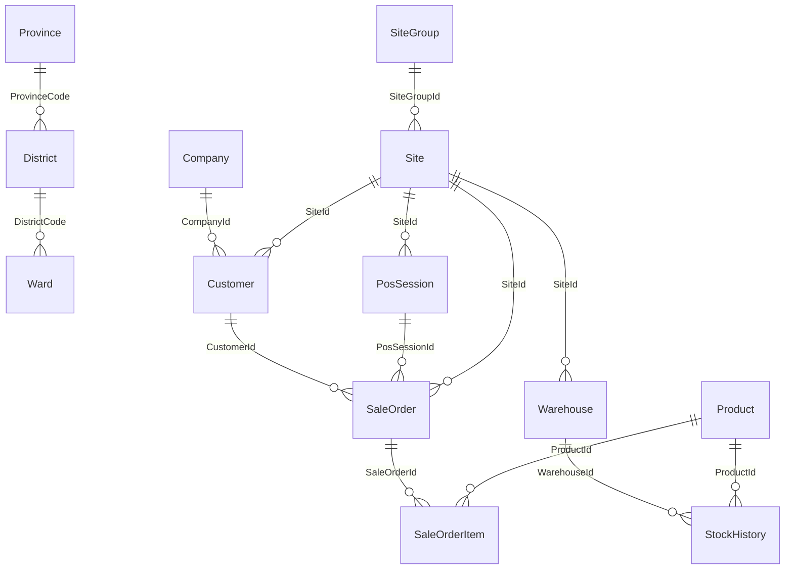

Tài liệu mô tả **cấu trúc logic và mối quan hệ** giữa các bảng trong database **`pos`** (PostgreSQL, schema `public`) phục vụ đội **Data Analytics / BI** và **Executive Dashboard**. Nội dung dựa trên **introspection metadata** (`information_schema`) trên một bản snapshot — không nhúng host/credential.

**Chi tiết từng cột (255 bảng):** [schema-pos-postgresql-columns.md](./schema-pos-postgresql-columns.md) — sinh lại bằng `python tools/build_pos_schema_columns_md.py`.

## 1. Thống kê tổng quan

| Khía cạnh | Giá trị (snapshot) |
|-----------|-------------------|
| Schema phi nội bộ | `public` |
| Số bảng & view (`BASE TABLE` + ...) | **255** |
| Ràng buộc khóa ngoại (FK) | **582** |
| Phong cách | Nhiều bảng **PascalCase**; PK thường là **`uuid`**; trường **`DeleteAt`** cho soft-delete |

Scope lớn: POS + kho + khách hàng + nhân sự (chấm công), kế toán nội bộ, e-commerce, khuyến mãi, v.v. Phần dưới **làm rõ trục phân tích** (Site → Bán hàng → Dòng hàng → Sản phẩm / Kho); các bảng nghiệp vụ khác chỉ được **đề cập ở mức liên kết** khi FK đi vào các thực thể trục.

## 2. Quy ước dữ liệu quan trọng (DA)

- **Định danh**: Hầu hết thực thể nghiệp vụ dùng **`Id uuid`**; một số bảng địa lý dùng **`Code integer`** làm khóa (ví dụ `Province.Code`, `District.Code`, `Ward.Code`).
- **Soft delete**: Cột **`DeleteAt`** (timestamp nullable) — khi phân tích doanh thu / tồn kho / đơn, thường lọc **`DeleteAt IS NULL`** (đồng bộ dashboard cũng áp dụng nguyên tắc này).
- **Tiền tệ / số lượng**: Trên header đơn (`SaleOrder`) nhiều trường tiền là **`bigint`** (đơn vị nhỏ nhất của hệ thống — cần xác nhận với chủ hệ thống: VND × 1 hay × 1000). Giá/biến số nhỏ hơn có thể là **`double precision`**.
- **Thời gian**: Business timestamps (`IssueAt`, `CompleteAt`, …) kiểu **`timestamp with time zone`** — khi aggregate theo ngày, chuẩn hoá múi giờ (`AT TIME ZONE`) trước khi cắt ngày.
- **Đồng bộ ngoài**: `KiotVietSyncId`, `EcomSourceId`, … cho thấy dòng dữ liệu tích hợp — joins phải xử lý trùng nguồn / thứ tự ưu tiên nếu có.

## 3. Khối địa lý & hành chính

| Bảng | Khóa / ghi chú | Vai trò DA |
|------|----------------|------------|
| **`Province`** | `Code` (PK), `Name`; có cầu nối `NewProvinceCode` | Chuẩn tỉnh/TP; aggregate theo vùng Bắc–Trung–Nam khi map thủ công hoặc có bảng mapping. |
| **`District`** | `Code` FK → `Province.Code` | Quận/huyện; join `Site`, `Customer`, `Warehouse` qua `DistrictCode`. |
| **`Ward`** | FK → `District.Code` (có `NewWardCode`) | Phường/xã — địa chỉ chi tiết. |

**Cửa hàng (`Site`)** mang **`ProvinceCode`, `DistrictCode`, `WardCode`** và bản đồ địa chỉ mới **`NewProvinceCode`, `NewWardCode`, `NewFullAddress`** — có thể dùng song song trong giai đoạn chuyển đổi địa giới; DA cần quy tắc ưu tiên một bộ mã khi báo cáo.

## 4. Tổ chức: công ty, nhóm site, cửa hàng

| Bảng | Quan hệ chính | Vai trò DA |
|------|----------------|------------|
| **`Company`** | Gốc tổ chức | Phân tách đa công ty nếu dùng chung DB (hiếu thường gặp ở chain). |
| **`Customer.CompanyId`** | → `Company.Id` | Gán khách cho pháp nhân. |
| **`SiteGroup`** | **cây**: `ParentId` → `SiteGroup.Id` | Nhóm cửa hàng (vùng, chain con). |
| **`Site.SiteGroupId`** | → `SiteGroup.Id` | Gắn site vào nhóm để rollup mục tiêu / KPI theo cluster. |
| **`Site`** | Trục **địa điểm bán** | `Name`, `StoreName`, `Code`, `State`, địa chỉ, tọa độ `Lat`/`Long`, ca làm việc (`WorkingOn*`), VAT (`TaxCode`, …), `EcomSourceId`. Thực thể **trung tâm** cho doanh thu & attendance. |

**Nhân sự tại site**: `SiteStaff` (**SiteId**, **StaffId**), `WorkingShiftSite`, các bảng phạm vi `*ApplyScopeSite` — hữu ích cho workload & lịch nhưng ngoài trục đơn/kho chính.

## 5. Khách hàng

| Bảng | Quan hệ | Vai trò DA |
|------|---------|------------|
| **`CustomerGroup`** | Dimension nhóm KH | Phân khúc, pricing, campaign. |
| **`Customer`** | FK: `CompanyId`, `CustomerGroupId`, `MinCustomerGroupId`; địa chỉ qua `Province/District/Ward`; **`SiteId` → Site** (KH gắn site mặc định / quản lý); có **`ParentId` → Customer** (cấp bậc/B2B?) | **RFM**, cohort, debt (`CurrentDebtAmount`), tổng mua (`TotalSaleAmount*`), `LastTransactionAt`, chuẩn hoá phone. |
| Liên kết đơn | `SaleOrder.CustomerId`, `PaymentOrder`, `ReturnSaleOrder`, v.v. | Chuỗi hành vi mua — grain đơn = `SaleOrder`. |

## 6. Sản phẩm & danh mục

| Bảng | Quan hệ | Vai trò DA |
|------|---------|------------|
| **`Product`** | FK: `ProductCategoryId`, `BrandId`, `MasterUnitId` (self), `StockLocationId`, `VatTypeId`, … | SKU: giá (`SalePrice*`, `CostPrice`), trạng thái `State`/`Type`, tồn snapshot `StockQuantity`, cờ bán POS / VAT. |
| **`ProductSite`** | **ProductId**, **SiteId** | Sản phẩm mở bán theo site. |
| **`Brand`, `ProductCategory`** | Chiều phân loại | Slice doanh thu / margin theo ngành hàng. |

## 7. Trục bán hàng: phiên POS → đơn → dòng hàng

### 7.1 Phiên bán hàng

| Bảng | Quan hệ | Vai trò DA |
|------|---------|------------|
| **`PosSession`** | **`SiteId` → Site** | Một “ca” POS tại cửa hàng. |
| **`PosSessionStaff`** | PosSession ↔ Staff | Ai mở/ca. |

### 7.2 Đơn bán (`SaleOrder`)

- **Khóa**: `Id` (uuid). **Gắn cửa hàng**: **`SiteId` → Site**; **khách**: `CustomerId`; **phiên**: `PosSessionId`; **nhân viên**: `StaffId`, `RefractionistStaffId`; **workflow**: `WorkflowId`, `StateId` → `Workflow` / `WorkflowState`.
- **Thời điểm**: `IssueAt`, `SubmitAt`, **`CompleteAt`** (thường dùng cho **doanh thu ghi nhận**), `CancelAt`.
- **Tiền** (đại diện): `ProductAmount`, `DiscountAmount`, **`NeedPayAmount`**, `PaidAmount`, `CustomerPaid`, `SubTotalCostPrice`; VAT: `VatAmount`, `NeedPayAmountIgnoreVat`, …
- **Tích hợp / nguồn**: `SaleChannelId`, **`EcomSourceId`**, `PreOrderId`, `PackingListId`, `StockAdjustmentId`, `MerchantSiteCode`, shipping (`IsInstantShipping`, …).

**Grain chuẩn báo cáo đơn**: **một dòng = một `SaleOrder`**; lọc đơn hoàn tất (`CompleteAt` không null, `DeleteAt` null) là pattern phổ biến.

## 7.5 Data dictionary tóm tắt (bảng lõi)

Mục này tóm tắt **các trường quan trọng** và **nội dung lưu trữ** trong các bảng trục dùng cho dashboard/BI. Để xem **toàn bộ cột + kiểu/FK** (255 bảng), mở: `docs/schema-pos-postgresql-columns.md`.

### `Site` (cửa hàng/điểm bán)

- **Mục đích**: dimension trung tâm cho phân tích theo cửa hàng.
- **Trường hay dùng**:
  - `Id`: định danh cửa hàng (uuid, ổn định).
  - `Name`, `StoreName`, `Code`: tên/mã hiển thị.
  - `SiteGroupId`: nhóm/cluster cửa hàng.
  - `ProvinceCode`, `DistrictCode`, `WardCode` (+ bộ `New*`): địa lý/địa chỉ.
  - `Lat`, `Long`: toạ độ (nếu có).
  - `State`: trạng thái hoạt động.
  - `DeleteAt`: soft-delete.

### `SaleOrder` (đơn bán - header)

- **Mục đích**: fact “một đơn”; grain: **1 dòng = 1 đơn**.
- **Trường hay dùng**:
  - `Id`: định danh đơn (uuid).
  - `SiteId`: cửa hàng tạo đơn.
  - `CustomerId`: khách hàng (nullable).
  - `IssueAt`, `SubmitAt`, `CompleteAt`, `CancelAt`: mốc thời gian; thường dùng **`CompleteAt`** để ghi nhận doanh thu.
  - `NeedPayAmount`: doanh thu net thu từ khách (sau giảm giá/VAT tuỳ cấu hình hệ thống).
  - `DiscountAmount`, `TotalDiscountAmount`, `PromotionDiscountAmount`: giảm giá.
  - `PaidAmount`, `CustomerPaid`: thanh toán.
  - `SaleChannelId`, `EcomSourceId`: kênh bán / nguồn e-com.
  - `DeleteAt`: soft-delete.

### `SaleOrderItem` (dòng hàng)

- **Mục đích**: fact theo SKU trong đơn; grain: **1 dòng = 1 SKU trong 1 đơn**.
- **Trường hay dùng**:
  - `SaleOrderId`: FK về đơn.
  - `ProductId`: FK về SKU.
  - `Quantity`: số lượng.
  - `SubTotal`: doanh thu dòng.
  - `SubTotalCostPrice` (hoặc `CostPrice`): giá vốn dòng (COGS) để tính **gross_profit**.
  - `IsPromotionGift`: dòng quà tặng khuyến mãi.
  - `DeleteAt`: soft-delete.

### `Customer` (khách hàng)

- **Mục đích**: dimension khách hàng phục vụ retention/CLV/cohort/RFM.
- **Trường hay dùng**:
  - `Id`: định danh khách.
  - `Phone`, `Email`, `FullName`/`Name`: thông tin liên hệ.
  - `CustomerGroupId` / `MinCustomerGroupId`: phân nhóm.
  - `SiteId`: cửa hàng gắn mặc định/quản lý.
  - `CurrentDebtAmount`: công nợ hiện tại.
  - `TotalSaleAmount`, `TotalSaleAmountIgnoreVat`: tổng mua lũy kế.
  - `LastTransactionAt`: giao dịch gần nhất.
  - `DeleteAt`: soft-delete.

### `SaleChannel` / `EcomSource` (dimension kênh)

- **Mục đích**: dimension cho “channel mix”.
- **Trường hay dùng**:
  - `Id`, `Name` (và `Code` nếu có).
  - `DeleteAt`: soft-delete.

### `PromotionCampaign` / `PromotionCampaignSaleOrder` (khuyến mãi theo chiến dịch)

- **Mục đích**: gắn đơn vào chiến dịch để đo hiệu quả chiến dịch.
- **Trường hay dùng**:
  - `PromotionCampaign.Id`, `Name`, `Code`, `StartAt`, `EndAt`, `State`.
  - `PromotionCampaignSaleOrder.PromotionCampaignId`, `SaleOrderId`.
  - `DeleteAt`: soft-delete.

### `MeasurementTicket` (khám mắt/đo mắt)

- **Mục đích**: proxy traffic/funnel (nếu quy trình có phát sinh ticket).
- **Trường hay dùng**:
  - `Id`, `SiteId`, `CustomerId` (nếu có), `IssueAt`.
  - `DeleteAt`: soft-delete.

### `Warehouse` / `StockHistory` / `StockItem` (kho & tồn)

- **Mục đích**: kho theo cửa hàng và fact biến động tồn.
- **Trường hay dùng**:
  - `Warehouse.Id`, `SiteId`, `Name`, `AllowNegativeInventory`, `DeleteAt`.
  - `StockHistory.WarehouseId`, `ProductId`, `CreateAt`, `Quantity`, `EndStock`, `CostPrice`, `IsReturn`, `RefType`, `RefId`, `DeleteAt`.
  - `StockItem.WarehouseId`, `ProductId`, `InboundAt`, `OutboundAt`, `DamageAt`, `CostPrice`, `DeleteAt`.

### `Product` / `Brand` / `ProductCategory` (dimension SKU)

- **Mục đích**: dimension để phân tích theo ngành hàng/brand/SKU.
- **Trường hay dùng**:
  - `Product.Id`, `Code`, `Name`, `ProductCategoryId`, `BrandId`, `SalePrice*`, `CostPrice`, `Type`, `State`, `DeleteAt`.
  - `Brand.Id`, `Name`, `DeleteAt`.
  - `ProductCategory.Id`, `Name`, `DeleteAt`.

### `ReturnSaleOrder` / `ReturnSaleOrderItem` / `SupplierWarranty` (đổi trả/bảo hành)

- **Mục đích**: proxy chất lượng thay CSAT; thống kê lỗi/đổi trả.
- **Trường hay dùng**:
  - `ReturnSaleOrder.Id`, `SiteId`, `SaleOrderId`, `CompleteAt`, `NeedPayAmount`/`ProductAmount`, `Note`, `DeleteAt`.
  - `ReturnSaleOrderItem.ReturnSaleOrderId`, `SaleOrderItemId`, `ProductId`, `Quantity`, `Reason`/`Note` (nếu có), `DeleteAt`.
  - `SupplierWarranty.Id`, `SiteId`, `IssueAt`, `WarrantyReason` (nếu có), `DeleteAt`.

### 7.3 Dòng đơn (`SaleOrderItem`)

- **Khóa**: `Id`; **`SaleOrderId` → SaleOrder**; **`ProductId` → Product**.
- **Số lượng & giá**: `Quantity`, `OriginalPrice`, `Price`, `ActualPrice`, `SubTotal`; chiết khấu dòng; **`SubTotalCostPrice`**, `CostPrice` — **COGS / biên lời dòng**.
- **Thuế**: `VatTypeId`, `VatAmount`, `AmountIgnoreVat`.
- **Khuyến mãi**: cờ `IsPromotionGift`, liên kết `PromotionCampaignItemId`, v.v.

### 7.4 Luồng liên quan (rút gọn)

- Thanh toán: **`PaymentOrder`** (`SaleOrderId`, `SiteId`, `CustomerId`, `PaymentMethodId`, …).
- Trả hàng: **`ReturnSaleOrder`**, **`ReturnSaleOrderItem`** (trỏ `SaleOrderId`, `SaleOrderItemId`).
- Đối soát kho bán: **`SaleOrderStockItem`**, **`OutboundDelivery`**, **`PackingList*`** — liên kết đơn với xuất vật lý.

## 8. Trục kho: kho hàng ↔ lịch sử tồn

| Bảng | Quan hệ | Vai trò DA |
|------|---------|------------|
| **`Warehouse`** | **`SiteId` → Site**; địa chỉ song song `Site` | Một site có thể có nhiều kho; `AllowNegativeInventory`. |
| **`StockHistory`** | **`WarehouseId` → Warehouse**, **`ProductId` → Product**; `Quantity`, `EndStock`, `CostPrice`, `IsReturn`, `RefType`/`RefId` | **Fact chuyển động tồn** theo thời gian (`CreateAt`); dùng cho cover days, dead stock proxy, reconciliation. |
| **`StockItem`** | (Warehouse, Product) | Snapshot tồn theo cặp kho–SP. |
| **`StockAdjustment`**, **`StockTransferOrder`**, **`InboundDelivery`** … | FK vào `Warehouse`, `Product`, `Site` | Điều chỉnh, chuyển kho, nhập hàng — ảnh hưởng tồn và giá vốn. |

**Chuỗi join kinh điển tồn kho**: `Site` → `Warehouse` → `StockHistory` → `Product`.

## 9. Sơ đồ quan hệ lõi (Mermaid)

*Lưu ý*: Sơ đồ trên chỉ mô tả **khối trục**; trong DB còn **hàng trăm** FK khác từ promotion, HR, supplier, v.v.

## 10. Bảng tra cứu FK tiêu biểu (rút gọn)

| Nguồn | Cột | Đích | Cột | Ý nghĩa phân tích |
|--------|-----|------|-----|-------------------|
| SaleOrder | SiteId | Site | Id | Gán doanh thu cho cửa hàng. |
| SaleOrder | CustomerId | Customer | Id | Hành vi & cohort KH. |
| SaleOrder | PosSessionId | PosSession | Id | Gán theo ca POS. |
| SaleOrderItem | SaleOrderId | SaleOrder | Id | Grain dòng đơn. |
| SaleOrderItem | ProductId | Product | Id | Mix sản phẩm, COGS dòng. |
| Warehouse | SiteId | Site | Id | Định vị kho theo site. |
| StockHistory | WarehouseId | Warehouse | Id | Chuỗi thời gian tồn. |
| StockHistory | ProductId | Product | Id | SP trong kho. |
| Customer | SiteId | Site | Id | Gắn KH với điểm bán. |

## 11. Góc nhìn DA: chỉ số & grain

| Chủ đề | Grain gợi ý | Công thức / nguồn gốc |
|--------|----------------|------------------------|
| Doanh thu ngày/cửa hàng | `Site` × `DATE(CompleteAt)` từ `SaleOrder` | SUM(`NeedPayAmount`), điều chỉnh theo đơn vị tiền; loại trừ hủy (`CancelAt`). |
| Gross margin | Đơn hoặc dòng | Từ `SaleOrderItem.SubTotal`, `SubTotalCostPrice` (xác nhận đơn vị & thuế). 
| Đơn hàng / đơn vị | Ngày × Site | COUNT đơn, SUM `Quantity` từ line. |
| Churn / repeat (proxy) | Khách × tháng | Cần logic cohort từ chuỗi `SaleOrder` theo `CustomerId` — các proxy trong dashboard có thể khác định nghĩa “churn”. |
| Tồn kho | Tháng × Site × (optional Product) | `StockHistory` hoặc snapshot `StockItem`; join `Warehouse` → `Site`. |

**Rủi ro phân tích**: định nghĩa đơn hoàn thành, đơn trả, đơn đổi (`ExchangeParentId`), đa nguồn (`EcomSourceId`) — cần **data contract** thống nhất với nghiệp vụ trước khi public KPI.

## 12. Data contract tối thiểu trước go-live dashboard

_Added: 2026-05-11_

Các KPI đã có thể chạy read-only nếu snapshot SQLite còn dữ liệu, nhưng go-live production cần chủ hệ thống xác nhận các contract dưới đây để tránh dashboard hiển thị proxy như số liệu chính thức.

| Chủ đề | Bảng/cột nguồn cần chốt | Trạng thái hiện tại trong dashboard | Điều kiện go-live |
|--------|--------------------------|-------------------------------------|-------------------|
| Doanh thu & GPM | `SaleOrder.SiteId`, `SaleOrder.CompleteAt`, `SaleOrder.NeedPayAmount`, `SaleOrderItem.SubTotal`, `SaleOrderItem.SubTotalCostPrice`, trạng thái hủy/trả | Đã dùng làm nguồn chính | Chốt định nghĩa đơn hoàn thành, đơn hủy, đơn đổi/trả và đơn vị tiền. |
| Campaign | `PromotionCampaign`, `PromotionCampaignSaleOrder`, liên kết tới `SaleOrder`, ngân sách/CAC nếu có | Có doanh thu/campaign; CAC/budget còn proxy hoặc thiếu | Xác nhận bảng liên kết campaign có đủ coverage và cung cấp budget/cost nếu cần ROI/CAC thật. |
| Target | Bảng target vận hành hoặc custom `POS_TARGETS_SQL` | Có fallback/coverage, chưa đảm bảo target thật | Cần contract target tháng theo `site_id`/`region_id`, metric, kỳ áp dụng. |
| CSAT/quality | Bảng CSAT/service survey nếu có; fallback hiện dùng `ReturnSaleOrder`, `ReturnSaleOrderItem`, `SupplierWarranty` | Đang là quality proxy | Nếu KPI gọi là CSAT/NPS thật, cần bảng khảo sát hoặc đổi nhãn thành return/warranty proxy. |
| Traffic/funnel | `MeasurementTicket`, walk-in/traffic source, `SaleOrder`, `PaymentOrder` | Funnel có proxy; `MeasurementTicket` từng rỗng ở nguồn thật | Cần xác nhận grain từng bước funnel và bảng traffic/walk-in thật. |
| Customer/RFM/cohort | `Customer`, `SaleOrder.CustomerId`, `CompleteAt`, doanh thu net/refund | RFM/cohort đã có snapshot; cohort vẫn có phần proxy | Cần định nghĩa khách mới/quay lại/mất, xử lý khách không có `CustomerId`, refund và merge customer. |
| Inventory SKU | `StockHistory`, `StockItem`, `Warehouse`, `Product`, `Brand`, `ProductCategory` | Monthly inventory ổn; SKU chi tiết là nhóm sync nặng | Chỉ bật `inventory_sku` khi DB/read-replica chịu tải và query timeout đã được kiểm soát. |

Vận hành production nên đặt `POS_PG_READ_DSN` để đồng bộ từ read replica; không chạy job lịch trực tiếp lên primary POS nếu chưa được DBA phê duyệt.

## 13. Cập nhật metadata schema (kỹ thuật)

Để tái xuất danh mục bảng / cột / FK (không đưa vào Git):

1. Cấu hình **`POS_PG_DSN`** hoặc file `executive_dashboard/.env.pg`.
2. Chạy: `python tools/introspect_pos_schema_once.py` — sinh `tools/_pos_schema_snapshot.json` (file lớn, **nên thêm vào `.gitignore`** nếu team không muốn lưu local).

---

*Tài liệu này phục vụ mô tả quan hệ & grain phân tích; không thay thế data dictionary đầy đủ 255 bảng. Có thể bổ sung từng module (HR, Supplier, Commission) theo nhu cầu báo cáo.*
